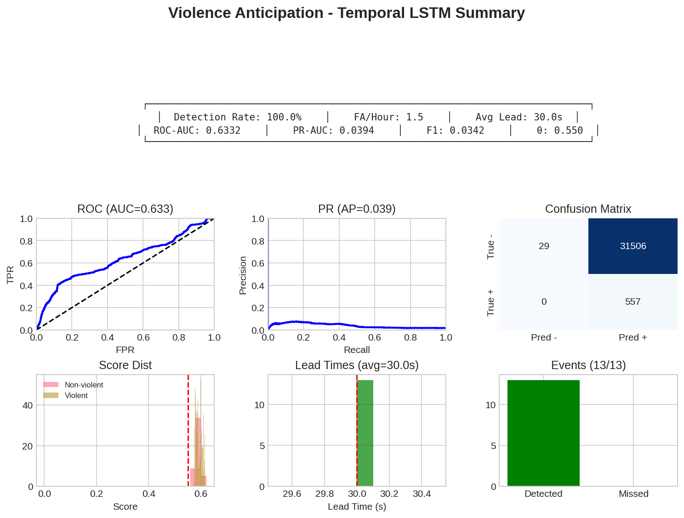
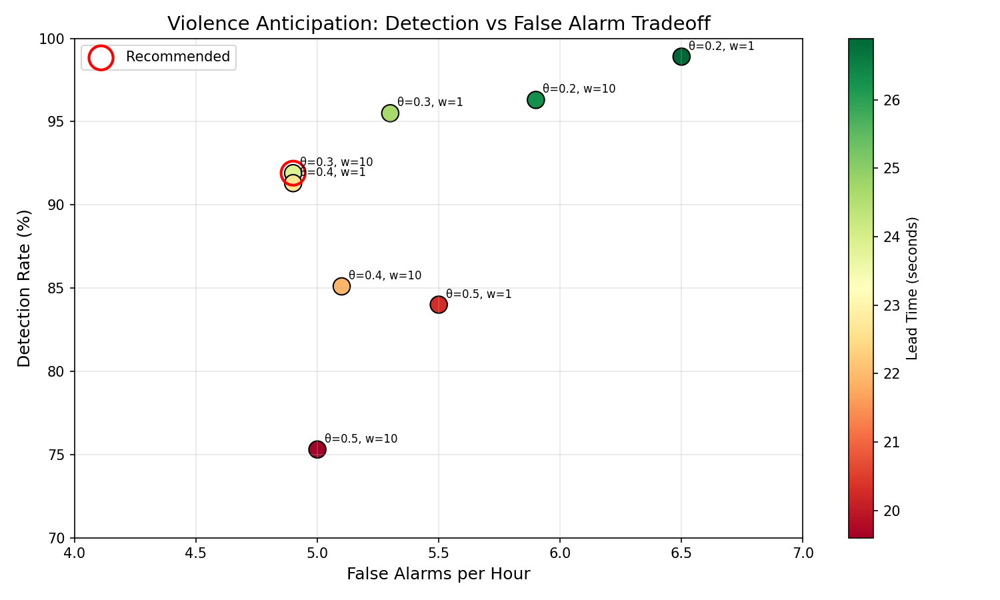

# Repository cleanup plan

Status: **EXECUTED on 2026-10-14** (step 1 commit and tag by the lead; steps 0 and 2 to 11 and the checks of
step 12 by the cleanup agent; the step 12 commit and push are left to the lead). The owner's amendments in
section 0 override the plan below wherever they disagree. Plan written 2026-10-14 from four read-only area audits
(root files; weight and generated-data folders; result folders; legacy source folders) plus a regret check, merged
here with every conflict resolved. Sizes come from `du`, tracked status from `git ls-files` / `git check-ignore`,
duplicates from `md5sum` / `cmp`.

Goal: remove the leftovers of abandoned strategies (gen-1 graph transformer, BiLSTM/contrastive heads, LoRA, fusion,
"8-hour" simulations, experiment suites) so the repo holds only the new pipeline (`anticipation/`, `benchmark/`,
`setup/`, `tools/`, `tests/`, `docs/`), the honest baseline, and a small frozen `legacy/` folder kept for provenance.

Three things must happen before anything else (details in section 5, steps 0 and 1):

1. **Save the only producer of two root MLPs today.** the shell history file is at its 2000-line cap,
   and the two `python -c` sessions that trained `synthetic_anticipation_mlp.pt` and `best_synthetic_anticipation.pt`
   sit at lines 20-207 and 209-386. Lines 1-18 have already started rolling off, so a few more shell sessions will
   erase them.
2. **Commit the new pipeline.** `anticipation/data/`, `anticipation/eval/`, most of `anticipation/features/`,
   all of `benchmark/`, `setup/download_*`, `setup/build_hivau_onsets.py`, `tests/test_va30*.py` and
   `docs/{DATA_ACQUISITION,FEATURES,VA30}.md` are **untracked**. They are in no commit, so a stray `git clean` or
   `rm` would destroy them beyond recovery. Commit them, then tag that commit `pre-cleanup`.
3. **Pause other agents** working in this repo while the plan runs. `benchmark/results/` was being written at 20:00
   on 2026-10-14.

---

## 0. Execution record and amendments (2026-10-14)

Amendments from the owner and lead, applied during execution:

1. **Nothing unique is deleted.** The plan's DELETE_UNTRACKED and DOCUMENT_THEN_REMOVE items that are unique data
   were archived instead of removed: all 97 intermediate gen-1 epochs (D2, D3; the whole `checkpoints/` and
   `best_checkpoints/` folders) and all 8 LoRA per-epoch adapters (`lora_finetuned/checkpoint_epoch{1,2,3}`,
   `lora_finetuned_v2/checkpoint_epoch{1..5}`). Deleted outright, each after an md5 check where a kept copy exists:
   `test_video.mp4` (md5 `6f23c7b689d52397fb19c91b63753093`, same as `data/anticipation_curation/videos/holdout_025.mp4`),
   the 11 duplicate `final/*/scores.npy` (md5 `dfa2ce21fb8bb904ce3bd6ec2be9c638`, same as the archived
   `final/smoothing_sweep/scores.npy`), the empty `.part`/`.ytdl` stubs, empty folders (`lora_finetuned/worker_{0,1}`,
   `snapshots/`, `.locks/`, three empty `final/` runs) and `__pycache__`/`.pytest_cache`.
2. **The YouTube cookies file was not deleted.** It moved outside the repository to a private location (md5 checked).
3. **No chmod on data directories.** The "mode 777" reading below came from `ls -l` on the `data`
   symlink (symlinks always show `lrwxrwxrwx`). Its target is
   755, and `archive/`, `archive/repo_legacy/` and `archive/baseline_weights/` are 755 with `go-w` on their contents.
4. **Grace period 90 days: purge date 2027-01-12**, recorded in `archive/repo_legacy/README.md` (that file replaces
   the plan's `README.txt`), in [README.md](README.md) section 8, in `legacy/README.md` and in the `docs/codebase/` banners.
5. Open questions: Q4 `baselines/reference_runs/` as planned; Q5 `yolov8m-pose.pt` stays in the repo root; Q6
   `setup/curate_youtube.py` as planned; Q9 the benchmark parquet files were committed in step 1; Q11 `docs/codebase/`
   stays in place with the pre-cleanup banner; Q13 `requirements.txt` was regenerated from the imports of
   `anticipation/`, `baselines/`, `setup/`, `tools/`, `tests/`, pinned to the `.venv` versions.

What happened, with sizes:

| Action | Files | Size | Where |
|---|---|---|---|
| Synthetic-MLP sessions extracted from the shell history (lines 20-207, 209-386, unchanged) | 2 | 12 KB | `archive/repo_legacy/synthetic_mlp_sessions_2026-03-02/` (mode 600) |
| Trusted weights backed up | 4 | 26 MB | `archive/baseline_weights/` (+ `MD5SUMS`) |
| KEEP relocated with `git mv` | 93 tracked + 4 ignored `best.pt` | 9.4 MB + 26 MB | `baselines/` (train_student_original.py, 8 reference runs) |
| `curate_anticipation_dataset.py` renamed | 1 | 28 KB | `setup/curate_youtube.py` |
| Figures kept for docs (D5, D7 copies; D8 `git mv`) | 4 | 0.27 MB | `docs/figures/` |
| LEGACY_CODE `git mv` | 31 | 0.54 MB | `legacy/` (+ new `legacy/README.md`) |
| Ignored artifacts archived (plan list + amendment 1), md5-verified (`ARCHIVE_OK`) | 1,791 (+ 2 JSON copies) | 6.14 GB | `archive/repo_legacy/` (`ARCHIVE_LIST.txt`, 76 entries; `MD5SUMS`) |
| Tracked files removed with `git rm` | 840 | 62.1 MB | recover with `git checkout pre-cleanup -- <path>` |
| Deleted (duplicates, stubs, empty dirs, caches) | 14 files + caches | 23 MB | none (see amendment 1) |

`archive/` is `data/archive/`. Working tree without `.venv/` and `.git/`:
108 MB after the cleanup. `git status` shows 838 deletions because rename detection pairs two of the 840 removed
files with their identical copies in `docs/figures/`. Optional step 11 item 8 (the docstring path in
`anticipation/features/pose.py`) was not applied, because the feature-extraction run was reading `anticipation/`
at the time.

Incident during review: running `legacy/setup/build_xdviolence_metadata.py --help` (the script takes no arguments)
regenerated `data/metadata/xd_violence.json` at 2026-10-14 21:08:30 (new md5 `360644296ea8c48d62eb18b831afdaee`).
No earlier copy exists to compare byte for byte. Its inputs (`raw_videos/xd_violence/annotations.txt`, `videos/`)
are unchanged since 2025-11-18. The new file has the documented 798 entries and 226 label=1, and its fps and
total_frames match `benchmark/videos.csv` for all 798 clips. `legacy/README.md` now warns against running it.

---

## 1. Summary

| Action | Manifest rows | Files | Size | Reversible? |
|---|---|---|---|---|
| KEEP (stays, or relocated with `git mv` outside `legacy/`) | 19 | all new-pipeline files + 4 honest runs + 4 teacher evals | about 108 MB in the tree (plus `.venv/` 8.7 GB, `.git/` 42 MB) | n/a |
| LEGACY_CODE (`git mv` to `legacy/`) | 13 | 31 | 0.54 MB | yes (git) |
| REMOVE_TRACKED (`git rm`) | 41 | 811 | 59.4 MB | yes, from tag `pre-cleanup` |
| ARCHIVE_UNTRACKED (move to `archive/repo_legacy/`) | 24 | about 1,668 | 4.46 GB | yes, during the grace period |
| DELETE_UNTRACKED (`rm`) | 10 | about 160 (+ 19 cache dirs) | about 530 MB | **no** (trivially regenerable or worthless) |
| DOCUMENT_THEN_REMOVE | 8 | 140 | 1.17 GB (1.157 GB deleted, 10.9 MB archived, 2.8 MB tracked) | partly (tracked: git; untracked epochs and duplicates: **no**) |
| **Total** | **115** | | | |

Effect: the working tree without `.venv/` and `.git/` shrinks from 6.0 GB to about 0.11 GB. About 4.47 GB moves to
`data/archive/repo_legacy/` on a second volume. About 1.7 GB is deleted.
Nothing the new pipeline or the B0 baseline reads is touched. Verified by grep: `anticipation/`, `benchmark/`,
`setup/download_*`, `setup/build_hivau_onsets.py`, `tests/test_va30*.py` and the four kept tools import no legacy
module. Their only links to legacy material are `data/metadata/*.json`, `data/processed/vlm_labels*`,
`data/anticipation_curation/` (all outside the repo) and the `yolov8m-pose.pt` fallback weight (kept).

### 1.1 Conflicts between the audits, and how they were resolved

| Item | Audits said | Decision |
|---|---|---|
| Honest runs `runs/student_fix1`, `runs/student_fix2`, `outputs/student_mlp`, `results/anticipation_prboost_v3`, and `results/vlm_eval*` | LEGACY to `legacy/results/` vs KEEP `best.pt` in place | **KEEP**, relocated to `baselines/reference_runs/<name>/` by moving whole directories, so each ignored `best.pt` moves with its folder. A `legacy/` label would say "do not use" about the numbers to beat. The four `best.pt` files are also backed up to `archive/baseline_weights/`. |
| `final/*/scores.npy` (13 files) | archive all vs document and delete 11 duplicates | 11 are byte-identical (md5 `dfa2ce21...`) to `final/smoothing_sweep/scores.npy`, so they are **deleted after a doc note**. The 2 unique score arrays and 2 `predictions.npz` are archived. |
| `experiments/README.md` | LEGACY vs REMOVE | **REMOVE**: it documents only the removed Mar 16 scripts and never mentions `fast_analyze_curation.py`. |
| Root `train/val/test_index.json` | `legacy/splits/` | **`legacy/` root.** `training/evaluate.py` opens `val_index.json` relative to the CWD. If that file is missing, it silently evaluates on an index built from ALL graphs. |
| `scripts/build_anticipation_labels.py` | REMOVE | **LEGACY**: it is the only producer of `labels_future_h*`, the labels behind the cited teacher number 0.772 (`vlm_eval_future_h30`). |
| YouTube cookies file | KEEP ("probably expired") | **DELETE**: it holds live session cookies and was readable by every user of the machine, and its only consumer (Kinetics downloader) is removed. Never archive it. |
| `.env` | KEEP | KEEP + `chmod 600` (it was readable by every user). |
| Synthetic root MLPs | document in prose | First extract the two `python -c` blocks verbatim into the archive, then document. |
| `outputs/outputs_temporal/{args.json,final_metrics.json}` | git rm with the group | Copy them into the archive next to the archived checkpoint, then git rm. They are the only record of how to rebuild that model. |
| Recovery pointer in docs | commit 2164ca4 | Tag `pre-cleanup` (the commit that adds the new pipeline). 86 `.py` files changed after 2164ca4, and `docs/` did not exist then. |
| `training/train_student_original.py` | KEEP | KEEP, relocated to `baselines/`. A one-file top-level `training/` would sit beside `legacy/training/`. |
| `curate_anticipation_dataset.py` | KEEP | KEEP, relocated to `setup/curate_youtube.py` next to the other acquisition scripts. |
| `.venv/` (8.7 GB) | not audited | KEEP, and exclude it from every untracked or ignored sweep. |

---

## 2. Proposed final layout

```
violence_anticipation/
  anticipation/        New pipeline package: data catalog, onsets, labels, folds (data/), VA30 metrics and
                       control baselines (eval/), 1 Hz feature extractors (features/)
  benchmark/           VA30 artifacts: videos.csv, events.json, folds_v1/v2.json, near_duplicates.json,
                       catalog_summary.json, results/<baseline>/
  baselines/           Honest gen-2 reference: train_student_original.py (B0 trainer) and reference_runs/
                       (4 movie-grouped StudentMLP runs + 4 zero-shot Qwen teacher evals)
  docs/                Documentation: README (index), BASELINE, VA30, FEATURES, DATA_ACQUISITION,
                       EXPERIMENT_HISTORY, REPO_CLEANUP_PLAN, codebase/ (audit of the old code), research/, figures/
  legacy/              Frozen code kept only as provenance for files in data/ and for cited numbers
                       (README.md explains how to run it with cwd=legacy)
  setup/               Data acquisition: XD train split, UBI-Fights, HIVAU onsets, self-test/verify,
                       curate_youtube.py (curated YouTube hold-out)
  tests/               VA30 unit tests
  tools/               server_load.py, cpu_governor.sh, contact_sheet.py, check_comment_only_diff.py
  data -> data/   videos, metadata, features, archive/ (symlink, ignored)
  models -> models/               pretrained weights (symlink, ignored)
  .venv/               Python 3.10 environment (ignored)
  (agent notes)        not published
  README.md            Short pointer to docs/ with the honest status
  requirements.txt     Dependency list (to be regenerated, see open questions)
  .gitignore
  .env                 YouTube API key (ignored, chmod 600)
  yolov8m-pose.pt      Fallback pose weight hard-coded in anticipation/features/pose.py (ignored)
```

`legacy/` contents (31 tracked files):

```
legacy/
  README.md                       what each file produced, how to run, warnings
  train_index.json, val_index.json, test_index.json    leaky gen-1 clip split (1438/180/180); never a benchmark
  configs/{paths,training}.yaml   read CWD-relative by training/train.py and training/evaluate.py
  core/                           gen-1 ViolenceTransformer, extractors, graph builder (loads the archived checkpoints)
  training/{__init__,train,dataset,evaluate,train_temporal_model}.py
  scripts/{__init__,preprocess_anticipation,generate_labels,vlm_label_dataset,build_multihorizon_labels,
           build_anticipation_labels,eval_vlm_teacher,analyze_youtube}.py
  vlm/{__init__,qwen_teacher}.py  producer of data/processed/vlm_emb* and vlm_labels* (B0 and B-teacher inputs)
  realtime/{__init__,rtsp_inference,inspect_checkpoint}.py
  experiments/fast_analyze_curation.py   producer of the curated set's LSTM pseudo-onsets
  setup/build_{ucf_crime,xdviolence}_metadata.py   producers of data/metadata/*.json (read by the new pipeline)
```

Top-level entries that disappear: `core/ training/ configs/ scripts/ vlm/ realtime/ sim/ tuning/ continuation/
llm/ llm_data/ experiments/ final/ results/ outputs/ outputs_fused/ runs/ simulation_data/ simulation_results*/
checkpoints/ best_checkpoints/ lora_finetuned*/ logs/ snapshots/ .locks/ .pytest_cache/ __pycache__/`, plus 25 root files.

---

## 3. Full manifest, grouped by action

Abbreviations: T = tracked, U = untracked/ignored, M = mixed. "Readers" = code or docs that use the path.

### 3.1 KEEP

| Path | Size | T | Reason / readers |
|---|---|---|---|
| `anticipation/` | 1.2 MB | M | The new pipeline. Only 3 files are tracked; commit the rest in step 1. |
| `benchmark/` | 19 MB | U | VA30 catalog, events, folds, baseline results; `videos.csv` is the only in-repo list of the 92 curated hold-out videos. Commit in step 1. |
| `docs/` | 756 KB | M | Central documentation. Commit `DATA_ACQUISITION.md`, `FEATURES.md`, `VA30.md` in step 1; path updates in step 11. |
| `setup/{__init__.py, download_*.py, download_*.sh, build_hivau_onsets.py}` | 156 KB | M | New data acquisition (XD train, UBI-Fights, HIVAU-70k onsets). Untracked except `__init__.py`: commit in step 1. |
| `tools/{server_load.py, contact_sheet.py, check_comment_only_diff.py, cpu_governor.sh}` | 16 KB | T | Required by the project's agent notes (not published): server etiquette, comment rule. |
| `tests/{__init__.py, test_va30.py, test_va30_fixes.py}` | 48 KB | M | VA30 tests (import only `anticipation.*`). Commit the two test files in step 1. |
| `training/train_student_original.py` -> `baselines/train_student_original.py` | 72 KB | T | The only correctly aligned trainer and the B0 reproduction path (BASELINE.md 2.5). Standalone (stdlib/numpy/torch). Its CWD-relative `data/...` defaults still work from the repo root. |
| `runs/student_fix1`, `runs/student_fix2`, `outputs/student_mlp`, `results/anticipation_prboost_v3` -> `baselines/reference_runs/<name>/` | 34 MB (72 tracked files 7.7 MB + 4 ignored `best.pt` 26 MB) | M | The four TRUSTED movie-grouped runs (test AUC 0.562-0.622), the numbers to beat. `splits_manifest.json` (identical in all 4, md5 `faac9ae5...`) is the only exact record of the B0 split. Move whole directories so `best.pt` travels along, verify md5, and back up the 4 `best.pt` to `archive/baseline_weights/`. |
| `results/vlm_eval`, `results/vlm_eval_future_h5`, `_h10`, `_h30` -> `baselines/reference_runs/` | 1.7 MB (20 files) | T | Zero-shot Qwen teacher reference (XD AUC 0.776 / 0.772), cited in BASELINE.md as the no-training bar. |
| `curate_anticipation_dataset.py` -> `setup/curate_youtube.py` | 28 KB | T | Provenance and re-download tool for `data/anticipation_curation/` (92 videos, the planned real-world hold-out). `load_dotenv()` walks up from the script's directory, so it still finds the root `.env`. Its `analyze`/`export` subcommands lazily import `vlm.qwen_teacher` and need `PYTHONPATH=legacy`. They are circular pseudo-labellers and should not be used for ground truth. |
| `yolov8m-pose.pt` | 51 MB | U | Hard-coded `FALLBACK_WEIGHTS` in `anticipation/features/pose.py:89` (absolute repo-root path). Public Ultralytics weight. Moving it is optional (open question 5). |
| `README.md` | 8 KB | T | Stale (describes a never-built system). Keep, and rewrite in step 11 as a short pointer to `docs/`. |
| Agent notes | 12 KB | T | Agent instructions (not published). Update the codebase map and pitfalls in step 11. |
| `requirements.txt` | 4 KB | T | Incomplete (covers only `rtsp_inference.py`). Regenerating it is a follow-up. |
| `.gitignore` | 4 KB | T | Extend in step 11. Keep the now-dead `checkpoints/`, `simulation_data/`, `lora_finetuned*/` lines: they also guard `legacy/` runs. |
| `.env` | 4 KB | U | Holds the YouTube API key for the curation script. Never in git history. `chmod 600` in step 2. Never archive it. |
| `data`, `models` (symlinks) | links | U | External storage used everywhere. |
| `.venv/` | 8.7 GB | U | The project interpreter (BASELINE.md 2.5 uses it). Exclude from every sweep. |
| `.git/` | 42 MB | - | Repository. |

### 3.2 LEGACY_CODE (`git mv` to `legacy/<same relative path>`, except the index files, which go to `legacy/`)

| Path | Size | T | Reason / readers |
|---|---|---|---|
| `core/` (`__init__`, `model`, `graph`, `extractors`, `utils`) | 28 KB | T | Needed by `scripts/preprocess_anticipation.py`, which produced `data/processed/graphs`. The graphs' T axis defines the `labels_multih` row grid and the `vlm_emb` `t` key that B0 uses. Also needed to load the archived gen-1 checkpoints. `extractors.py` loads YOLOv8n/VideoMAE/CLIP at import. |
| `training/{__init__,train,dataset,evaluate}.py` | 24 KB | T | Gen-1 trainer and evaluator behind the documented re-evaluation (core_and_training.md 10). `train.py` overwrites `train_index.json`, which is safer inside `legacy/`. |
| `training/train_temporal_model.py` | 36 KB | T | Reference definition of `TemporalViolenceModel` (GELU). It trained `outputs/outputs_temporal/best_temporal_model.pt`, which produced the curated pseudo-onsets that VA30 marks as `pseudo`. |
| `configs/{paths,training}.yaml` | 8 KB | T | Read CWD-relative (`configs/...`) by `train.py` and `evaluate.py`. |
| `scripts/{__init__,preprocess_anticipation,generate_labels}.py` | 16 KB | T | Producers of `data/windowed/` and `data/processed/{tracks,actions,scenes,audio,graphs,labels}`. `generate_labels` is imported by `preprocess_anticipation`. |
| `scripts/{vlm_label_dataset,build_multihorizon_labels}.py` | 40 KB | T | Producers of `vlm_emb*`/`vlm_labels*` (B0 and B-teacher inputs) and `labels_multih` (B0 labels). **Warning for legacy/README:** `vlm_label_dataset.py` writes to `data/processed/vlm_labels` and `vlm_emb` by default, so rerunning it would overwrite the B0 inputs. |
| `scripts/{eval_vlm_teacher,build_anticipation_labels}.py` | 28 KB | T | Reproduce the cited teacher numbers (`vlm_eval*`) and their `labels_future_h{5,10,30}` (regret-check correction). |
| `scripts/analyze_youtube.py` | 24 KB | T | Offline counterpart of the RTSP demo; produced the `probe_clip_01` probe. Its `sys.path` hack (parent.parent) resolves to `legacy/`, which works because `vlm/` moves too. |
| `vlm/` (`__init__`, `qwen_teacher`) | 44 KB | T | Qwen2.5-VL wrapper behind every `vlm_emb*`/`vlm_labels*` file. |
| `realtime/{__init__,rtsp_inference,inspect_checkpoint}.py` | 24 KB | T | The only working live path, and the deployment reference (realtime_and_misc.md 11). It writes `inference_*.log` and `snapshots/` to the CWD. |
| `experiments/fast_analyze_curation.py` | 24 KB | T | Provenance of the LSTM pseudo-onsets in `data/anticipation_curation/candidates.json` and `vlm_emb/curated/`. |
| `setup/build_{ucf_crime,xdviolence}_metadata.py` | 8 KB | T | Producers of `data/metadata/*.json`, which `anticipation/eval/baselines.py` (fps) and the B0 trainer still read. The XD builder has the documented onset bug. Run them by file path: `python -m setup.x` resolves to the root `setup/` package. |
| `train_index.json`, `val_index.json`, `test_index.json` -> `legacy/` | 287 KB | T | The leaky gen-1 clip split (1438/180/180; 44 of 83 XD test clips share a source with train). Defines the split behind every legacy result. It moves to `legacy/` root because the gen-1 code opens it CWD-relative. Entries are `data/processed/...` paths, so gen-1 runs from `legacy/` need a `legacy/data -> ../data` symlink (gitignored). |

### 3.3 REMOVE_TRACKED (`git rm`; recover with `git checkout pre-cleanup -- <path>`)

Root files:

| Path | Size | T | Reason / readers |
|---|---|---|---|
| `analysis_probe_clip_01.png` | 72 KB | T | Plot from the n=1 YouTube probe. Its numbers (frame AUC 0.718, all scores at least 0.515, max 0.767 after the labelled violence) are in EXPERIMENT_HISTORY 2.14 and results_inventory 3H. No code reads it. |
| `eval_index.json` | 32 KB | T | Byte-identical to `test_index.json` (cmp). Written by `training/evaluate.py` and `tools/make_nonoverlap_splits.py`; read only by the removed `tools/check_split_overlap.py`. |
| `inference_20260226_225311.log`, `inference_20260302_185137.log` | 140 KB | T | RTSP demo logs, no ground truth. Facts (825 and 75 inferences, 1 alert each at 0.5044 / 0.5059, about 0.4 s per VLM embedding, 2 ms per LSTM call) are recorded in results_inventory and EXPERIMENT_HISTORY 2.14. They contain emoji markers. |
| `progress.sh` | 4 KB | T | One-off monitor for the finished Feb 20 VLM extraction (realtime_and_misc.md 8). |
| `mediamtx.yml` | 4 KB | T | Superseded RTSP server config with placeholder credentials. Fully described in realtime_and_misc.md 8. |
| `__init__.py` | 0 | T | Makes the repo root a package. Together with `tests/__init__.py` it makes plain `pytest` import `violence_anticipation.tests.*` and put the parent directory on `sys.path`. Removing it lets `import anticipation` work under plain `pytest`. |

Result folders (all INVALID or FLAWED; every number already in results_inventory.md 3A-3H and EXPERIMENT_HISTORY.md):

| Path | Size | T | Reason / readers |
|---|---|---|---|
| `results/anticipation_{multih_hset, multih_hset_v2, _v3, _v4, _v4_ema085_k2_gap5_fap7, _v4_ema085_k2_gap5_fap7_late3, _v4_ema085_k3_gap2_fap7, prboost_v2}` (tracked files) | 15.8 MB, 138 files | T | Random video split (movie leakage, D4): test AUC 0.83-0.944; `hset_v3` threshold 1.0. Ignored `best.pt` -> ARCHIVE row A20. |
| `results/anticipation_preonly_h30_grace1_ignore{,_fp1.._fp4,_meanpool}` (tracked) | 2.2 MB, 44 files | T | Pre-onset-only labels, no negative videos, val AUC 0.48-0.55, threshold always positive (EXPERIMENT_HISTORY 2.5). Not reproducible with today's code. |
| `results/contrastive_results` (tracked: args, dimension_importance, PNGs) | 0.44 MB, 5 files | T | Producer no longer in the repo; contrastive gave no gain (2.10). Ignored weights -> A19. |
| `results/{algorithm_comparison,ema_results,prompt_engineering,ucf_crime_results}.csv` | 2 KB, 4 files | T | Mar 16 suite: mixed metrics, in-sample LDA 1.0, all-NaN UCF (3H, 2.15). |
| `results/xd_investigation` | 3 KB, 2 files | T | Conclusion recorded (C6, 2.15) and superseded by data_and_labels.md 3 and `benchmark/catalog_summary.json`. Its own stats are internally broken (e.g. Burglary005: 927 violent frames in a 61-frame video). Downgrade it in the docs from TRUSTED to FLAWED. |
| `outputs/outputs_temporal{,_old,_old_emb,_violence,_vlm_emb,_fused,_vlm_audio,_audio_only}`, `outputs/outputs_projected` (tracked) | 9.9 MB, 137 files | T | INVALID BiLSTM runs (val 0.53-0.72, test 0.76-0.99). Copy `outputs/outputs_temporal/{args.json,final_metrics.json}` into the archive first (step 6). Weights -> A12, A13. |
| `outputs/contrastive_v2_large`, `outputs/contrastive_v3` (tracked) | 0.4 MB, 7 files | T | Val-only or leaky (v3 test 0.903, val 0.656). Weights -> A16, A17. |
| `outputs/qa_feature_test` (tracked: `summary.json`, `analysis.png`) | 124 KB | T | VQA features, logistic AUC 0.486 (chance). `features.npz` -> A18. |
| `outputs_fused/` (tracked) | 1.1 MB, 15 files | T | VLM+flow BiLSTM (val 0.721, test 0.920 leaky). Weights -> A14. |
| `runs/{outputs,outputs_xd,outputs_ucf}/results.json` | 5 KB, 3 files | T | Focal-loss MLP, D1-D5, oracle thresholds (2.8). Weights -> A22. |
| `final/` (all tracked files except `final_evaluation_lstm_2/` and `detection_fa_tradeoff.png`) | 16.0 MB, 258 files | T | Every folder INVALID or FLAWED (stitched sims of 81 % training videos, misaligned labels, test-tuned thresholds, capped lead). Source of the misleading 0.98 AUC / 0 FA/h headlines. Only the removed `continuation/time_to_violence.py` reads it. |
| `simulation_results/`, `simulation_results_contrastive/`, `simulation_results_ensemble/`, `simulation_results_temporal/` | 265 KB, 11 files | T | FLAWED runs on the 8-hour sim (3A, 2.13). Legacy simulators recreate these by default, so add `.gitignore` entries. |
| `logs/` | 4.1 MB, 12 files | T | Audio extraction, VLM scan, LoRA and failed RTSP logs. Facts recorded: 1721 VLM videos, LoRA val acc 0.4925 every epoch, audio shards, RTSP failure. The new pipeline logs to `data/logs/`. |
| `llm_data/` | 3.1 MB, 4 files | T | Failed text-LLM head (video AUC 0.588, leaky prompts; vlm_and_llm.md 7, 2.3). |
| `experiments/output/` (tracked JSON/PNG of exp1-exp4) | 4.8 MB, 90 files | T | FLAWED Apr 2026 outputs; numbers in results_inventory 3D/3H and 2.16. exp3 weights -> A23. |

Code (all superseded, broken or documented as invalid; facts in docs/codebase/*.md):

| Path | Size | T | Reason / readers |
|---|---|---|---|
| `training/eval_anticipation.py`, `training/train_student.py` | 52 KB | T | Gen-1 TTD evaluator (misaligned, never produced output) and the focal-loss MLP with `labels[:len(emb)]` (D1-D5). Superseded by VA30 and `train_student_original.py`. |
| `scripts/{benchmark,export_trace_graph,visualize_graphs}.py` | 12 KB | T | Broken gen-1 tools (missing sample, wrong dims, no main). |
| `scripts/{quick_inspect,inspect_risk_curves,split_train_val}.py` | 16 KB | T | Gen-1 inspection plots (hard-coded path, wrong time axis) and the old splitter that overwrites `train_index.json`. |
| `scripts/build_labels_temporal_only.py` | 12 KB | T | Producer of `labels_preonly_*`/`labels_temporal_only`, used only by the invalid preonly runs. Commands recorded in data_and_labels.md 8. |
| `scripts/{audio_feature_extraction,pose_feature_extraction,check_audio_availability}.py`, `tuning/optical_flow_features.py` | 84 KB | T | Old extractors on the wrong clock (71.6 % zero audio, 70 % clamped pose). Superseded by `anticipation/features/{audio_dsp,audio_events,speech,voice,pose,motion}.py`. `pose.py:41` mentions the old pose script in its docstring (historical). |
| `scripts/{build_fused_features,multimodal_fusion,late_fusion}.py`, `tuning/fuse_features.py` | 96 KB | T | Fusion experiments with clock bugs, leakage, test-tuned weights (2.12). |
| `scripts/evaluate_with_smoothing.py` | 16 KB | T | Its corrected protocol now lives in `anticipation/eval/va30.py`; its own results are invalid (ReLU/GELU mismatch, test-set sweeps). |
| `llm/` (5 files), `scripts/build_llm_dataset.py` | 44 KB | T | Failed text-LLM head. `llm_embedder`/`llm_head` are imported only by the removed `realtime/pipeline.py`. |
| `scripts/vlm_build_student_dataset.py` | 12 KB | T | Dead code; output never built. |
| `scripts/preprocess_kinetics_for_videomae.py`, `setup/{kinetics_download_relevant,kinetics_list_labels,enrich_kinetics_metadata,preprocess_kinetics_actions,videomae_finetune_kinetics}.py` | 24 KB | T | Kinetics branch (10 s clips, synthetic onset), useless for anticipation and not used by VA30. `kinetics_download_relevant.py` was the only consumer of `youtube_cookies.txt`. |
| `sim/` (9 files) | 152 KB | T | "8-hour shift" builders and evaluators, all D1-D6; "do not reuse" (simulation_and_evaluation.md 7.1). |
| `tuning/{contrastive_finetune,contrastive_projection,contrastive_simulator,ensemble_simulator}.py` | 72 KB | T | SupCon projectors and ensembles, misaligned labels, no gain (2.10). |
| `tuning/lora_finetune_vlm.py`, `tuning/question_analysis/` | 76 KB | T | Collapsed LoRA (val acc 0.4925) and chance VQA features (vlm_and_llm.md 5-6). |
| `continuation/` (3 files) | 44 KB | T | ETA heuristic anchored on an invalid 26.9 s lead (prints emojis), LDA calibration probe, domain adaptation never run (simulation_and_evaluation.md 4.11-4.13). |
| `experiments/{algorithm_variations,baseline_comparisons,ema_smoothing,prompt_engineering_stats,ucf_crime_testing,xd_violence_investigation}.py`, `run_all_experiments.sh`, `README.md` | 108 KB | T | Mar 16 suite with the sorted-`rglob` loader bug (2.15). README documents only these. |
| `experiments/{run_experiments,exp1_person_detection}.py` | 72 KB | T | exp1-exp4 with test-tuned thresholds (2.16). Last code user of `yolov8n.pt` besides `core/extractors.py`. |
| `realtime/pipeline.py` | 4 KB | T | Dead gen-1 loop (random weights, shape crashes, loads about 4 models at import). |
| `tests/{test_extractors,test_graph_builder,test_realtime_graph,tests_model_forward}.py` | 16 KB | T | Stale gen-1 tests; none pass (core_and_training.md 13). |
| `tools/{check_split_overlap,make_nonoverlap_splits,debug_embeddings,debug_sources,diagnose_gap}.py` | 32 KB | T | Old clip-split helpers and throwaway debug scripts; superseded by `anticipation/data/folds.py` and `benchmark/folds_v*.json`. |
| `configs/{model,features}.yaml` | 8 KB | T | Never read by any code (verified by grep); `model.yaml` contradicts the real model. |

### 3.4 ARCHIVE_UNTRACKED (move to `data/archive/repo_legacy/<same relative path>`)

| # | Path | Size | T | Reason / readers |
|---|---|---|---|---|
| A1 | `simple_mlp_model.pt`, `regularized_mlp.pt`, `full_dataset_mlp.pt`, `ucf_crime_mlp.pt`, `anticipation_mlp.pt`, `full_anticipation_mlp.pt`, `backward_anticipation_mlp.pt`, `filtered_anticipation_mlp.pt` | 20.7 MB | U | Orphaned Mar 2 state dicts from lost `python -c` sessions; no producer, no metrics, nothing reads them. Exact shapes are recorded by D1. |
| A2 | `yolov8n.pt` | 6.3 MB | U | Public Ultralytics detector, used only by legacy `core/extractors.py` (CWD-relative; Ultralytics re-downloads it if missing) and the removed exp1. |
| A3 | `probe_clip_01_embeddings.npy`, `probe_clip_01_scores.npy` | 2.7 MB | U | n=1 YouTube probe arrays; hand labels and per-phase means already in results_inventory. Source video not on disk. Only code readers (`continuation/`) are removed. |
| A4 | `good_video_indices.npy` | 4 KB | U | int64[433] indices into the 772-video sim list. The only record of the circular "lowfa" selection (overlaps 396/433). Producer lost. Travels with `simulation_data/`. |
| A5 | `checkpoints/model_epoch10.pt`, `checkpoints/model_epoch60.pt`, `best_checkpoints/model_epoch40.pt` | 36 MB | U | The three gen-1 epochs cited in the core_and_training.md 10 re-evaluation table. Kept so that table stays reproducible. |
| A6 | `lora_finetuned/{best_model,final_model,history.json,training_history.json}`, `lora_finetuned_v2/{best_model,final_model,history.json}` | 244 MB | U | Final and best adapters of the collapsed LoRA runs ("do not reuse"; nothing loads them). Provenance only; the first candidate to drop at the end of the grace period. |
| A7 | `simulation_data/xd_violence_8hr_sim.npz`, `.meta.json`, `xd_violence_8hr_sim_violence.npz`, `.meta.json` | 475 MB | U | The legacy "headline" 8-hour stream kept for continuity in BASELINE.md 3.1 (AUC 0.853 / 0.834). |
| A8 | `simulation_data/xd_violence_8hr_flow_sim.npz`, `xd_violence_8hr_flow_sim_fused.npz` | 242 MB | U | Flow streams pasted from unrelated videos (AUC 0.557). |
| A9 | `simulation_data/xd_violence_vlm_{matched,filtered,clean,clean_t02,lowfa}.npz` | 997 MB | U | 81 % training videos; source of every invalid headline. **Builder not in the repo**, so these cannot be regenerated. |
| A10 | `simulation_data/xd_violence_8hr_fused.npz`, `xd_violence_vlm_audio.npz`, `xd_violence_audio_only.npz` | 1.23 GB | U | Fusion streams on wrong clocks (AUC 0.887 / 0.868 / 0.438, documented). |
| A11 | `simulation_data/xd_diluted_5pct_8hr.npz`, `ucf_crime_8hr_sim.npz` | 572 MB | U | Diluted sim (lead 0 by construction) and UCF cross-domain sim (AUC 0.459). |
| A12 | `outputs/outputs_temporal/best_temporal_model.pt` (+ copies of the tracked `args.json`, `final_metrics.json`) | 7.0 MB | U | Legacy default BiLSTM (val AUC 0.577). It produced the curated pseudo-onsets and is the default of the legacy RTSP/YouTube demos. The JSON copies record its architecture (input 3584, hidden 256, LSTM 128 x 2 layers, seq 30, XD, train_index.json). |
| A13 | `outputs/outputs_temporal_{old,old_emb,violence,vlm_emb,fused,vlm_audio,audio_only}/best_temporal_model.pt`, `outputs/outputs_projected/best_temporal_model.pt` | 50 MB | U | Invalid BiLSTM variants; unseeded, so not bit-reproducible. |
| A14 | `outputs_fused/best_temporal_model.pt` | 7.0 MB | U | Invalid VLM+flow BiLSTM. |
| A15 | `outputs/contrastive_v1/`, `outputs/outputs_contrastive/` (whole dirs, untracked) | 29 MB | U | SupCon V1 projectors + test projections; no gain. |
| A16 | `outputs/contrastive_v2_large/model.pt` | 121 MB | U | Largest legacy head; no test metrics, producer version gone. First to drop after the grace period. |
| A17 | `outputs/contrastive_v3/model.pt`, `outputs/contrastive_v3/projected_emb/` (772 npz) | 61 MB | U | V3 projector and 256-d projected embeddings (C1 labels). |
| A18 | `outputs/qa_feature_test/features.npz` | 12 KB | U | VQA feature arrays (chance). |
| A19 | `results/contrastive_results/projection_model.pt`, `results/contrastive_results/projected_emb/` (772 npz) | 56 MB | U | Attention projector whose producer is gone; input of the invalid `outputs_projected` run. Not regenerable. |
| A20 | `results/anticipation_*/best.pt` for the 15 non-honest runs (7 `multih_hset*`, `prboost_v1`, `prboost_v2`, 6 `preonly*`) | 69 MB | U | StudentMLP weights of leaky or chance-level runs. |
| A21 | `results/transformer_model.pt` | 3.0 MB | U | Whole-module pickle from `experiments/algorithm_variations.py` (INVALID); unpickling needs that removed script. |
| A22 | `runs/{outputs,outputs_xd,outputs_ucf}/best_model.pt` | 23 MB | U | Focal-loss MLPs; `outputs_xd` is the model behind the BASELINE.md 3.1 legacy row (AUC 0.853). |
| A23 | `experiments/output/exp3_cross_dataset/{xd_only,ucf_only,combined}/best_temporal_model.pt` | 21 MB | U | Overfit cross-dataset LSTMs (train 0.99, val 0.49-0.61). |
| A24 | `final/smoothing_sweep/scores.npy`, `final/clean_smoothing_sweep/scores.npy`, `final/late_fusion_matched/predictions.npz`, `final/late_fusion_max/predictions.npz` | 0.7 MB | U | The unique saved score traces of the invalid sims (results_inventory 7); meaningful only next to `simulation_data/`. |

### 3.5 DELETE_UNTRACKED (`rm`; irreversible)

| Path | Size | T | Reason / readers |
|---|---|---|---|
| `test_video.mp4` | 20 MB | U | yt-dlp test download, byte-identical (md5 `6f23c7b6...`) to `data/anticipation_curation/videos/holdout_025.mp4`. Docs that use it as a smoke-test clip should point to the curated copy. |
| `test_holdout_025.mp4.part`, `test_holdout_025.mp4.ytdl` | 50 B | U | Empty partial download and resume stub from the failed first attempt. |
| YouTube cookies file | 1.2 KB | U | Live session cookies, readable by every user of the machine. Its only consumer is removed. Never archive it. If future yt-dlp work needs cookies, export fresh ones into a `chmod 600` file outside the repo. **Amended (section 0): moved outside the repo, not deleted.** |
| `lora_finetuned_v2/checkpoint_epoch{1..5}/` | 455 MB | U | Per-epoch adapters of a collapsed run (val acc 0.4925 every epoch). `checkpoint_epoch1`'s adapter files are byte-identical to `best_model`'s (`best_model` also carries the tokenizer/processor files; archived). |
| `lora_finetuned/checkpoint_epoch{1,2,3}/`, `lora_finetuned/worker_0/`, `worker_1/` | 29 MB | U | Intermediate v1 adapters (documented in vlm_and_llm.md 5); `worker_*` are empty. |
| `final/{final_evaluation_student_mlp, late_fusion_optimization, smoothing_w3_t0.3}/` | 0 | U | Empty dirs from failed runs. |
| `snapshots/` | 0 | U | Empty; `rtsp_inference.py` recreates it on demand. |
| `.locks/` | 0 | U | Empty; default `--lock_dir` of `vlm_label_dataset.py`, recreated on demand. |
| `__pycache__/` (19 dirs, 133 `.pyc`) | 2.0 MB | U | Bytecode. Stale `.pyc` of removed modules could mask missing-module errors. |
| `.pytest_cache/` | 32 KB | U | Regenerated on the next test run. |

### 3.6 DOCUMENT_THEN_REMOVE (exact text in section 4)

| # | Path | Size | T | Removal | Reason |
|---|---|---|---|---|---|
| D1 | `synthetic_anticipation_mlp.pt`, `best_synthetic_anticipation.pt` | 10.9 MB | U | archive (with A1) | Producer found only in the shell history. Extract it verbatim, correct the docs' "no producer script" and the inferred widths, then archive. |
| D2 | `checkpoints/model_epoch{1..9,11..59}.pt` (58 files) | 691 MB | U | `rm` | Intermediate epochs of a leaky, non-causal run; never evaluated or cited. Only their timing is worth recording. |
| D3 | `best_checkpoints/model_epoch{1..39}.pt` (39 files) | 464 MB | U | `rm` | Same, for the earlier 40-epoch run. |
| D4 | `final/high_sensitivity/scores.npy` + 10 `final/smoothing_w*/scores.npy` | 2.1 MB | U | `rm` | All 11 byte-identical (md5 `dfa2ce21fb8bb904ce3bd6ec2be9c638`) to the archived `final/smoothing_sweep/scores.npy`. results_inventory 7 cites `high_sensitivity/scores.npy`. |
| D5 | `results/anticipation_prboost_v1` (17 tracked files; `best.pt` in A20) | 2.1 MB | T | `git rm` | INVALID, but the cleanest controlled leakage demonstration (same trainer and features as `student_fix1`, only the split differs). Save the ROC figures first. |
| D6 | `results/lda_calibration_results.txt` | 815 B | T | `git rm` | Docs record only the booleans; the per-phase numbers show the LDA direction is inverted on real footage. |
| D7 | `final/final_evaluation_lstm_2/` (metrics + 10 PNGs) | 624 KB | T | `git rm` | Its `summary.png` is the clearest illustration of the lenient event metric (always-on alarm scores 13/13). |
| D8 | `final/detection_fa_tradeoff.png` | 84 KB | T | `git mv` to `docs/figures/` | The old "recommended operating point" plot, useful as the before-picture next to the honest baseline. |

---

## 4. DOCUMENT_THEN_REMOVE: exact text to record, and where

Write all of this in step 4, before anything is removed. Every number below was re-checked against the files
on 2026-10-14.

**D1, root MLPs.** Target: `docs/codebase/results_inventory.md`, section "Root `*.pt`". Replace the intro paragraph
and the table with:

> ### Root `*.pt` (archived in the 2026-10 cleanup)
> Ten bare `state_dict`s of an `nn.Sequential` named `net` (Linear, ReLU, Dropout blocks; parameterized layers at
> indices 0/3/6(/9)): 3584-d Qwen2.5-VL embedding in, one logit out. They are not the `StudentMLP` of
> `train_student_original.py`, which starts with a LayerNorm. Exact shapes, read from the zip entry sizes:
>
> | File | Size | Layers |
> |---|---|---|
> | `simple_mlp_model.pt`, `ucf_crime_mlp.pt`, `anticipation_mlp.pt`, `filtered_anticipation_mlp.pt` | 3.74 MB each | 3584-256-64-1 |
> | `synthetic_anticipation_mlp.pt` | 3.74 MB | 3584-256-64-1, Dropout 0.4 |
> | `full_dataset_mlp.pt`, `full_anticipation_mlp.pt`, `backward_anticipation_mlp.pt` | 1.86 MB each | 3584-128-32-1 |
> | `regularized_mlp.pt` | 0.92 MB | 3584-64-1 |
> | `best_synthetic_anticipation.pt` | 7.63 MB | 3584-512-128-32-1, Dropout 0.3 |
>
> All were produced on 2026-03-02 (saved 10:33 to 13:35) by inline `python -c` sessions, never by a repo script.
> - `synthetic_anticipation_mlp.pt` (Adam lr 1e-4, weight decay 1e-3, 30 epochs, cuda:1) and
>   `best_synthetic_anticipation.pt` (Adam lr 5e-5, 50 epochs; the saved checkpoint is the epoch with the best AUC on
>   the held-out 20 %, i.e. selected on the test split, D5) came from two sessions preserved in the shell history.
>   They are extracted verbatim to `archive/repo_legacy/synthetic_mlp_sessions_2026-03-02/`. The sessions take a
>   violent segment from `vlm_emb` + `labels_multih` with `labels.max(axis=1) > 0` and `labels[:len(emb)]` (D1, D2;
>   really the 120 s pre-onset window). In front of it they splice a random 30 to 60 step non-violent lead-up cut
>   from a different video. The last 30 lead-up steps plus the segment are labelled 1, and 40 to 100 step non-violent
>   chunks serve as negatives. Frames are split randomly 80/20 at frame level (sklearn, `random_state=42`, leaky),
>   and the model was probed on YouTube `probe_clip_01`. The lead-up has no causal relation to the violence, so the
>   "anticipation" label is noise. No metrics survive.
> - The other eight came from earlier sessions the same morning that rolled out of the 2000-line shell history. No
>   producer or metrics survive. The names suggest UCF-only training (`ucf_crime_mlp`), pooled XD + UCF
>   (`full_dataset_mlp`) and a filtered video subset (`filtered_anticipation_mlp`, possibly `good_video_indices.npy`)
>   **(inferred)**.
>
> All ten were moved to `data/archive/repo_legacy/`. Orphaned; do not reuse.
> `yolov8m-pose.pt` (53 MB) stays in the repo root as the fallback of `anticipation/features/pose.py`. `yolov8n.pt`
> (6.5 MB, used only by legacy `core/extractors.py`) was archived.

Target: `docs/EXPERIMENT_HISTORY.md` 2.14. Replace the bullet "The root `*_mlp.pt` files (Mar 2) have no producer
script and no metrics; they are orphaned." with:

> - The ten root MLP state dicts of Mar 2 are orphaned. Two of them (`synthetic_anticipation_mlp.pt`,
>   `best_synthetic_anticipation.pt`) came from inline `python -c` sessions. Those sessions spliced unrelated
>   non-violent lead-ups in front of violent segments (noise labels), used a frame-level random split, and selected
>   the checkpoint on the test split. The other eight have no surviving producer. None has metrics. All were
>   archived; details in [results_inventory.md](codebase/results_inventory.md), "Root `*.pt`".

**D2 and D3, gen-1 intermediate epochs.** Target: `docs/codebase/core_and_training.md` section 10. Append to the
"Evidence of training" paragraph:

> Run timing (file mtimes, recorded before the 2026-10 cleanup): `checkpoints/` epoch 1 was saved 2025-12-18 14:41
> and epoch 60 at 18:05, about 3.5 min per epoch and about 3.5 GPU-h in total. `best_checkpoints/` epoch 1 was saved
> 2025-12-15 13:06 and epoch 40 at 15:14, about 3.3 min per epoch and about 2.2 GPU-h. Only the three epochs in the
> table below were kept, at `data/archive/repo_legacy/checkpoints/model_epoch{10,60}.pt`
> and `.../best_checkpoints/model_epoch40.pt`. The other 97 epochs (1.16 GB, never evaluated) were deleted.

In the same file, update the reproduction snippet in section 10 and the command in section 11:

```python
sys.path.insert(0, REPO + "/legacy"); os.chdir(REPO)   # index entries are data/... paths relative to the repo root
ARCH = "data/archive/repo_legacy"
m.load_state_dict(torch.load(f"{ARCH}/checkpoints/model_epoch60.pt", map_location="cpu")); m.eval()
for it in json.load(open("legacy/test_index.json")):
```

and `cd legacy && ../.venv/bin/python -m training.evaluate --ckpt $ARCH/checkpoints/model_epoch60.pt` (needs the
`legacy/data -> ../data` symlink described in `legacy/README.md`).

**D4, duplicate score arrays.** Target: `docs/codebase/results_inventory.md` section 7, row "Saved score traces".
Replace the Path cell with:

> `final/smoothing_sweep/scores.npy` [47,310], `final/clean_smoothing_sweep/scores.npy` [14,052],
> `final/late_fusion_*/predictions.npz`, now under `archive/repo_legacy/final/`. `final/high_sensitivity/scores.npy`
> and the 10 `final/smoothing_w*/scores.npy` were byte-identical to `final/smoothing_sweep/scores.npy`
> (md5 `dfa2ce21fb8bb904ce3bd6ec2be9c638`, the BiLSTM scores on `vlm_matched` before smoothing) and were deleted.

**D5, leakage demonstration figure.** Copy `results/anticipation_prboost_v1/roc_curve.png` to
`docs/figures/roc_random_split_prboost_v1.png` and `runs/student_fix1/roc_curve.png` to
`docs/figures/roc_grouped_split_student_fix1.png`. Target: `docs/EXPERIMENT_HISTORY.md` 2.6, append:

> Controlled leakage demonstration ([random split](figures/roc_random_split_prboost_v1.png) vs
> [source-movie-grouped split](figures/roc_grouped_split_student_fix1.png)). Both runs use the same trainer
> (`train_student_original.py`), the same `vlm_emb` + hashed VLM-tag features (3746-d vs 3744-d) and the same 30 s
> target. With a random per-clip split (`prboost_v1`), test AUC is 0.942 / AP 0.763 (XD 0.967). With the
> source_movie-grouped split (`student_fix1`), test AUC is 0.578 / AP 0.158 (XD 0.521). Validation AUC barely moves
> (0.829 vs 0.823). In the random split, 46 of 77 XD test clips share a source movie or YouTube id with training.

**D6, LDA calibration numbers.** Target: `docs/codebase/results_inventory.md` 3H, row
`results/lda_calibration_results.txt`, append to the Result cell:

> The mean LDA score per hand-labelled phase of `probe_clip_01` falls monotonically, safe > anticipation > violence >
> post, under every calibration: raw 0.510 / 0.423 / 0.404 / 0.172; z-score 0.888 / 0.860 / 0.845 / 0.364;
> percentile 0.895 / 0.887 / 0.884 / 0.418; CORAL 0.921 / 0.898 / 0.865 / 0.765; within-video relative
> 0.722 / 0.697 / 0.688 / 0.427. The XD-fitted LDA direction is inverted on real footage.

**D7, always-on alarm figure.** Copy `final/final_evaluation_lstm_2/summary.png` to
`docs/figures/legacy_always_on_alarm_artifact.png`. Target: `docs/EXPERIMENT_HISTORY.md` 2.13, after "Why none is
valid", add:

> 
> `sim/comprehensive_eval.py` on `xd_violence_8hr_sim.npz` at theta 0.55: the LSTM is positive on 31,506 of 31,535
> negative steps (accuracy 0.018, ROC-AUC 0.633, AP 0.039). It still scores 13/13 events detected, 1.46 FA/h and a
> 30.0 s mean lead, because an always-on alarm counts as about one false alarm per event window and lead is capped at
> 30 steps (D6).

**D8, claimed operating point.** `git mv final/detection_fa_tradeoff.png
docs/figures/legacy_invalid_detection_fa_tradeoff.png`. Target: `docs/EXPERIMENT_HISTORY.md` 2.13, add:

> 
> What the leaky pipeline claimed (INVALID): the temporal LSTM on `xd_violence_vlm_matched.npz` (772 XD clips,
> 81 % training videos), scored by a `scripts/evaluate_with_smoothing.py` sweep of theta and a centered
> (non-causal) window w on the evaluated stream, with 1 step treated as 1 s and lead capped at 30. Marked point
> theta 0.3, w 10: 327/356 = 91.9 % detection, 4.87 FA/h, 23.9 s lead. Honest counterpart
> (`baselines/reference_runs/student_fix1`, movie-grouped split, val threshold): 24/40 = 60 % of violent test videos
> alerted within 30 s of onset, median lead 7.8 s, 15.3 % of normal test videos false-alarm, and effectively 0 % at
> 30 s or more of lead.

Also update `docs/codebase/results_inventory.md` sections 0 and 5, which cite `final/detection_fa_tradeoff.png` and
`final/final_evaluation_lstm_2`: point them to the figures above.

**Other fact records that accompany removals (same commit):**
- `docs/codebase/results_inventory.md` 3H, row `results/xd_investigation/`: change TRUSTED to FLAWED and add
  "Internally inconsistent (e.g. Burglary005: 927 violent frames in a 61-frame video; '1000 videos' is the first N of
  a sorted rglob). The conclusion (little pre-onset context) is confirmed with correct labels in
  [data_and_labels.md](data_and_labels.md) section 3 and `benchmark/catalog_summary.json` (112 eligible videos)."
- `docs/codebase/vlm_and_llm.md` section 5: "`lora_finetuned_v2/best_model`'s adapter files are byte-identical to
  `checkpoint_epoch1` (`best_model` also carries the tokenizer/processor files), consistent with val accuracy never moving. Per-epoch adapters were deleted in the 2026-10
  cleanup; `best_model`, `final_model` and the history files are in `archive/repo_legacy/lora_finetuned*/`."
- `docs/codebase/realtime_and_misc.md` (lines 5, 51, 191, 372-373, 498) and `docs/codebase/data_and_labels.md`
  (lines 81-84): `test_video.mp4` was deleted as a duplicate; the same clip is
  `data/anticipation_curation/videos/holdout_025.mp4`.

---

## 5. Execution steps

Run in **bash**, from the repo root, in this order. Each step lists its checks; stop at the first failed check.
Steps marked **IRREVERSIBLE** destroy data that exists nowhere else. Commit messages follow the project's agent notes (not published).

```bash
REPO=.
ARCH=data/archive/repo_legacy
BW=data/archive/baseline_weights
cd "$REPO"
```

### Step 0. URGENT, do today: save the synthetic-MLP producer from shell history

```bash
install -d -m 755 data/archive "$ARCH" "$ARCH/synthetic_mlp_sessions_2026-03-02"
S="$ARCH/synthetic_mlp_sessions_2026-03-02/bash_history_snapshot.txt"
(umask 077; cp "$HISTFILE" "$S")                       # freezes the line numbers
grep -n '^python -c "$\|^"$' "$S" | head -6                 # 2026-10-14: 18:" 20:python -c " 207:" 209:python -c " 386:"
grep -n 'synthetic_anticipation_mlp.pt\|best_synthetic_anticipation.pt' "$S"   # 2026-10-14: 3, 194, 347, 353
# If the numbers moved, adjust the two ranges so block 1 contains the 'synthetic_anticipation_mlp.pt' save and
# block 2 the 'best_synthetic_anticipation.pt' save.
(umask 077; sed -n '20,207p'  "$S" > "$ARCH/synthetic_mlp_sessions_2026-03-02/session1_synthetic_anticipation_mlp.py.txt")
(umask 077; sed -n '209,386p' "$S" > "$ARCH/synthetic_mlp_sessions_2026-03-02/session2_best_synthetic_anticipation.py.txt")
grep -inE 'key|token|passw|secret|cookie' "$ARCH"/synthetic_mlp_sessions_2026-03-02/session*.txt   # expect no output
rm "$S"                                                    # the snapshot was only a copy of the shell history
```

### Step 1. Safety net: commit the new pipeline, tag, push

```bash
git status --short                                        # expect only '??' entries for the new pipeline
git add anticipation benchmark docs/DATA_ACQUISITION.md docs/FEATURES.md docs/VA30.md docs/REPO_CLEANUP_PLAN.md \
        setup/build_hivau_onsets.py setup/download_*.py setup/download_*.sh tests/test_va30.py tests/test_va30_fixes.py
git diff --cached --name-only | grep -E '\.(pt|pth|npz|npy|mp4|safetensors)$'   # expect no output
git status --short                                        # expect nothing left untracked
git commit -m "Add VA30 benchmark, new feature pipeline, data acquisition scripts and docs"
git tag -a pre-cleanup -m "State before the 2026-10 repo cleanup; recover removed files with: git checkout pre-cleanup -- <path>"
git push origin master && git push origin pre-cleanup
```

### Step 2. Secrets (the cookies-file deletion is IRREVERSIBLE, by intent)

```bash
# Move any local credential files out of the working tree and keep them private (mode 600).
```

### Step 3. Back up the four trusted weights (they are ignored, so git does not protect them)

```bash
install -d -m 755 "$BW"
rsync -aR runs/student_fix1/best.pt runs/student_fix2/best.pt outputs/student_mlp/best.pt results/anticipation_prboost_v3/best.pt "$BW/"
md5sum runs/student_fix1/best.pt runs/student_fix2/best.pt outputs/student_mlp/best.pt results/anticipation_prboost_v3/best.pt > "$BW/MD5SUMS"
(cd "$BW" && md5sum -c MD5SUMS)                            # expect 4 x OK
```

### Step 4. Document first (all DOCUMENT_THEN_REMOVE items, section 4)

```bash
mkdir -p docs/figures
cp final/final_evaluation_lstm_2/summary.png          docs/figures/legacy_always_on_alarm_artifact.png
cp results/anticipation_prboost_v1/roc_curve.png      docs/figures/roc_random_split_prboost_v1.png
cp runs/student_fix1/roc_curve.png                    docs/figures/roc_grouped_split_student_fix1.png
git mv final/detection_fa_tradeoff.png                docs/figures/legacy_invalid_detection_fa_tradeoff.png
# Now make the text edits from section 4 in: docs/codebase/results_inventory.md, docs/EXPERIMENT_HISTORY.md,
# docs/codebase/core_and_training.md, docs/codebase/vlm_and_llm.md, docs/codebase/realtime_and_misc.md,
# docs/codebase/data_and_labels.md.
git add docs
git commit -m "Record facts and figures from artifacts that the cleanup removes"
```

### Step 5. Relocate the KEEP items (git; reversible)

Move whole directories with `git mv <dir>`, never file by file. Git renames the directory on disk, so the ignored
`best.pt` moves with it.

```bash
mkdir -p baselines/reference_runs
git mv training/train_student_original.py baselines/train_student_original.py
git mv runs/student_fix1                 baselines/reference_runs/student_fix1
git mv runs/student_fix2                 baselines/reference_runs/student_fix2
git mv outputs/student_mlp               baselines/reference_runs/student_mlp
git mv results/anticipation_prboost_v3   baselines/reference_runs/anticipation_prboost_v3
for v in vlm_eval vlm_eval_future_h5 vlm_eval_future_h10 vlm_eval_future_h30; do git mv "results/$v" "baselines/reference_runs/$v"; done
git mv curate_anticipation_dataset.py    setup/curate_youtube.py
# Verify the weights arrived intact (expect 4 x OK). If a best.pt is missing, mv it by hand from its old folder.
sed -e 's#runs/student_fix#baselines/reference_runs/student_fix#' -e 's#outputs/student_mlp#baselines/reference_runs/student_mlp#' \
    -e 's#results/anticipation_prboost_v3#baselines/reference_runs/anticipation_prboost_v3#' "$BW/MD5SUMS" | md5sum -c -
```

### Step 6. Archive ARCHIVE_UNTRACKED + D1 (copy, verify, then remove sources)

```bash
cat > "$ARCH/ARCHIVE_LIST.txt" <<'EOF'
simple_mlp_model.pt
regularized_mlp.pt
full_dataset_mlp.pt
ucf_crime_mlp.pt
anticipation_mlp.pt
full_anticipation_mlp.pt
backward_anticipation_mlp.pt
filtered_anticipation_mlp.pt
synthetic_anticipation_mlp.pt
best_synthetic_anticipation.pt
yolov8n.pt
probe_clip_01_embeddings.npy
probe_clip_01_scores.npy
good_video_indices.npy
checkpoints/model_epoch10.pt
checkpoints/model_epoch60.pt
best_checkpoints/model_epoch40.pt
lora_finetuned/best_model
lora_finetuned/final_model
lora_finetuned/history.json
lora_finetuned/training_history.json
lora_finetuned_v2/best_model
lora_finetuned_v2/final_model
lora_finetuned_v2/history.json
simulation_data
outputs_fused/best_temporal_model.pt
outputs/outputs_temporal/best_temporal_model.pt
outputs/outputs_temporal_old/best_temporal_model.pt
outputs/outputs_temporal_old_emb/best_temporal_model.pt
outputs/outputs_temporal_violence/best_temporal_model.pt
outputs/outputs_temporal_vlm_emb/best_temporal_model.pt
outputs/outputs_temporal_fused/best_temporal_model.pt
outputs/outputs_temporal_vlm_audio/best_temporal_model.pt
outputs/outputs_temporal_audio_only/best_temporal_model.pt
outputs/outputs_projected/best_temporal_model.pt
outputs/contrastive_v1
outputs/outputs_contrastive
outputs/contrastive_v2_large/model.pt
outputs/contrastive_v3/model.pt
outputs/contrastive_v3/projected_emb
outputs/qa_feature_test/features.npz
results/contrastive_results/projection_model.pt
results/contrastive_results/projected_emb
results/transformer_model.pt
results/anticipation_multih_hset/best.pt
results/anticipation_multih_hset_v2/best.pt
results/anticipation_multih_hset_v3/best.pt
results/anticipation_multih_hset_v4/best.pt
results/anticipation_multih_hset_v4_ema085_k2_gap5_fap7/best.pt
results/anticipation_multih_hset_v4_ema085_k2_gap5_fap7_late3/best.pt
results/anticipation_multih_hset_v4_ema085_k3_gap2_fap7/best.pt
results/anticipation_prboost_v1/best.pt
results/anticipation_prboost_v2/best.pt
results/anticipation_preonly_h30_grace1_ignore/best.pt
results/anticipation_preonly_h30_grace1_ignore_fp1/best.pt
results/anticipation_preonly_h30_grace1_ignore_fp2/best.pt
results/anticipation_preonly_h30_grace1_ignore_fp3/best.pt
results/anticipation_preonly_h30_grace1_ignore_fp4/best.pt
results/anticipation_preonly_h30_grace1_ignore_meanpool/best.pt
runs/outputs/best_model.pt
runs/outputs_xd/best_model.pt
runs/outputs_ucf/best_model.pt
experiments/output/exp3_cross_dataset/xd_only/best_temporal_model.pt
experiments/output/exp3_cross_dataset/ucf_only/best_temporal_model.pt
experiments/output/exp3_cross_dataset/combined/best_temporal_model.pt
final/smoothing_sweep/scores.npy
final/clean_smoothing_sweep/scores.npy
final/late_fusion_matched/predictions.npz
final/late_fusion_max/predictions.npz
EOF
# Sanity: every entry must be untracked (expect no output) and must exist (expect no 'missing' lines)
xargs -a "$ARCH/ARCHIVE_LIST.txt" -d '\n' git ls-files --
while read -r p; do [ -e "$p" ] || echo "missing: $p"; done < "$ARCH/ARCHIVE_LIST.txt"
# Copy, preserving relative paths (about 4.47 GB, to a second volume). -r is needed explicitly with --files-from.
nice -n 10 ionice -c2 -n7 rsync -a -r -R --files-from="$ARCH/ARCHIVE_LIST.txt" ./ "$ARCH/"
# Copy-only: tracked files that document the archived default BiLSTM (they are git rm'd in step 9)
rsync -aR outputs/outputs_temporal/args.json outputs/outputs_temporal/final_metrics.json "$ARCH/"
# Checksums of the sources, verified against the archive copies
xargs -a "$ARCH/ARCHIVE_LIST.txt" -d '\n' -I{} find {} -type f -print0 | nice -n 10 xargs -0 md5sum > "$ARCH/MD5SUMS"
(cd "$ARCH" && nice -n 10 md5sum -c --quiet MD5SUMS) && echo ARCHIVE_OK
cat > "$ARCH/README.txt" <<EOF
Ignored artifacts moved out of $REPO on $(date +%F) by the repo cleanup (docs/REPO_CLEANUP_PLAN.md).
Relative paths are preserved. Source tag: pre-cleanup ($(git rev-parse --short pre-cleanup)). Checksums: MD5SUMS.
Nothing here is used by the new pipeline or by the B0 baseline. Delete after the grace period (see docs/README.md).
EOF
# ONLY after ARCHIVE_OK was printed: remove the sources. IRREVERSIBLE outside the archive.
xargs -a "$ARCH/ARCHIVE_LIST.txt" -d '\n' rm -rf --
chmod -R go-w "$ARCH" "$BW"
```

### Step 7. Delete DELETE_UNTRACKED and the deletable DOCUMENT_THEN_REMOVE items (IRREVERSIBLE)

Only after step 4 is committed and step 6 printed ARCHIVE_OK.

```bash
cmp test_video.mp4 data/anticipation_curation/videos/holdout_025.mp4 && rm -f test_video.mp4
rm -f test_holdout_025.mp4.part test_holdout_025.mp4.ytdl
rm -rf lora_finetuned_v2/checkpoint_epoch{1,2,3,4,5} lora_finetuned/checkpoint_epoch{1,2,3}
rmdir lora_finetuned/worker_0 lora_finetuned/worker_1 lora_finetuned lora_finetuned_v2
rm -f checkpoints/model_epoch{1..9}.pt checkpoints/model_epoch{11..59}.pt && rmdir checkpoints        # D2
rm -f best_checkpoints/model_epoch{1..39}.pt && rmdir best_checkpoints                                # D3
md5sum final/high_sensitivity/scores.npy final/smoothing_w*/scores.npy | awk '{print $1}' | sort -u    # expect only dfa2ce21fb8bb904ce3bd6ec2be9c638
rm -f final/high_sensitivity/scores.npy final/smoothing_w{10_cd60,10_t0.5,10_t0.6,10_t0.75,15,15_t0.4,15_t0.7,20,5_t0.6,5_t0.7}/scores.npy   # D4
rmdir final/final_evaluation_student_mlp final/late_fusion_optimization final/smoothing_w3_t0.3 snapshots .locks
find . \( -path ./.venv -o -path ./.git \) -prune -o -type d -name __pycache__ -prune -exec rm -rf {} +
rm -rf .pytest_cache
```

If `rmdir` fails, a directory still holds something unexpected. Inspect it; do not switch to `rm -rf`.

### Step 8. Move LEGACY_CODE (git; reversible)

```bash
mkdir -p legacy/training legacy/configs legacy/scripts legacy/realtime legacy/experiments legacy/setup
git mv core legacy/core
git mv vlm  legacy/vlm
git mv training/__init__.py training/train.py training/dataset.py training/evaluate.py training/train_temporal_model.py legacy/training/
git mv configs/paths.yaml configs/training.yaml legacy/configs/
git mv scripts/__init__.py scripts/preprocess_anticipation.py scripts/generate_labels.py scripts/vlm_label_dataset.py \
       scripts/build_multihorizon_labels.py scripts/build_anticipation_labels.py scripts/eval_vlm_teacher.py scripts/analyze_youtube.py legacy/scripts/
git mv realtime/__init__.py realtime/rtsp_inference.py realtime/inspect_checkpoint.py legacy/realtime/
git mv experiments/fast_analyze_curation.py legacy/experiments/
git mv setup/build_ucf_crime_metadata.py setup/build_xdviolence_metadata.py legacy/setup/
git mv train_index.json val_index.json test_index.json legacy/
```

Then write `legacy/README.md` (content in section 5.1).

### Step 9. `git rm` REMOVE_TRACKED + tracked DOCUMENT_THEN_REMOVE (reversible from tag `pre-cleanup`)

```bash
# Pre-checks. 1) No untracked or ignored file may remain in the folders being removed (expect no output):
git ls-files -o -- final results outputs outputs_fused runs simulation_results simulation_results_contrastive \
  simulation_results_ensemble simulation_results_temporal logs llm_data experiments sim tuning continuation llm \
  scripts training realtime configs tests tools setup
# 2) Expected tracked counts after steps 4, 5 and 8:
git ls-files -- results outputs runs final | wc -l          # expect 629
git ls-files -- scripts training realtime configs | wc -l   # expect 22
git rm -q analysis_probe_clip_01.png eval_index.json inference_20260226_225311.log inference_20260302_185137.log \
          progress.sh mediamtx.yml __init__.py
git rm -r -q final results outputs outputs_fused runs simulation_results simulation_results_contrastive \
             simulation_results_ensemble simulation_results_temporal logs llm_data experiments
git rm -r -q sim tuning continuation llm scripts training realtime configs
git rm -q tests/test_extractors.py tests/test_graph_builder.py tests/test_realtime_graph.py tests/tests_model_forward.py
git rm -q tools/check_split_overlap.py tools/make_nonoverlap_splits.py tools/debug_embeddings.py tools/debug_sources.py tools/diagnose_gap.py
git rm -q setup/kinetics_download_relevant.py setup/kinetics_list_labels.py setup/enrich_kinetics_metadata.py \
          setup/preprocess_kinetics_actions.py setup/videomae_finetune_kinetics.py
git status --short | grep -c '^D '                          # expect 840 (811 REMOVE_TRACKED + 29 from D5/D6/D7)
```

### Step 10. Remove leftover empty directories and caches

```bash
for d in final results outputs outputs_fused runs simulation_results simulation_results_contrastive simulation_results_ensemble \
         simulation_results_temporal logs llm_data experiments sim tuning continuation llm scripts training realtime configs \
         checkpoints best_checkpoints lora_finetuned lora_finetuned_v2 simulation_data snapshots .locks; do
  [ -e "$d" ] && find "$d" -depth -type d -empty -delete
  [ -e "$d" ] && { echo "LEFTOVER: $d"; find "$d" | head; }
done                                                         # expect no LEFTOVER lines
find . \( -path ./.venv -o -path ./.git \) -prune -o -type d -name __pycache__ -prune -exec rm -rf {} +
```

### Step 11. `.gitignore`, docs and README updates (git; reversible)

Append to `.gitignore`:

```
# --- Local links and default outputs of legacy scripts (run from legacy/) ---
/legacy/data
/legacy/models
inference_*.log
snapshots/
/outputs*/
/final/
/simulation_results*/
/legacy/outputs*/
/legacy/final/
/legacy/simulation_results*/
```

Mechanical path rewrites for the relocated KEEP items, which are live references:

```bash
sed -i -e 's#training/train_student_original\.py#baselines/train_student_original.py#g' \
       -e 's#runs/student_fix\([12]\)#baselines/reference_runs/student_fix\1#g' \
       -e 's#outputs/student_mlp#baselines/reference_runs/student_mlp#g' \
       -e 's#results/anticipation_prboost_v3#baselines/reference_runs/anticipation_prboost_v3#g' \
       -e 's#results/vlm_eval#baselines/reference_runs/vlm_eval#g' \
       -e 's#curate_anticipation_dataset\.py#setup/curate_youtube.py#g' \
    docs/README.md docs/BASELINE.md docs/EXPERIMENT_HISTORY.md docs/codebase/*.md docs/research/*.md
grep -rn 'student_mlp_repro' docs/BASELINE.md     # change that --out_dir to runs/b0_repro by hand
```

Hand edits:
1. **`docs/codebase/*.md` (all 8 files):** add this banner under the title:
   "> Paths in this file describe the tree before the 2026-10 cleanup. Surviving code is under `legacy/<same path>`;
   > the honest runs are under `baselines/reference_runs/`; removed tracked files: `git show pre-cleanup:<path>`;
   > ignored weights and arrays: `data/archive/repo_legacy/<same path>`
   > until <grace date>. See [../REPO_CLEANUP_PLAN.md](../REPO_CLEANUP_PLAN.md)."
2. **`docs/README.md`:**
   - Section 3: replace the layout table with the layout of section 2 of this plan.
   - Section 4, line 104: "YOLO weights in the repo root" becomes "`yolov8m-pose.pt` in the repo root (pose fallback)".
   - Section 5: entry points become `legacy/...` (run with cwd=legacy), `baselines/train_student_original.py` and
     `setup/curate_youtube.py`.
   - Section 7: replace the bullets "Run from the repo root..." and "Never run `python -m training.train`..." with
     "New code runs from the repo root; legacy code runs from `legacy/` (see `legacy/README.md`)".
   - Add a section "8. Repository cleanup (2026-10)" with this ledger: what moved to `legacy/` and `baselines/`; that
     removed tracked files are recoverable with `git checkout pre-cleanup -- <path>` (oldest snapshot: commit
     2164ca4); the archive location, `MD5SUMS` and grace date; the `archive/baseline_weights/` backup; what was
     deleted outright (97 gen-1 intermediate epochs, 8 LoRA epoch adapters, 11 duplicate score arrays, a duplicate
     test video, caches).
3. **`docs/BASELINE.md`:**
   - Section 3.1: the legacy sim and models now live under `archive/repo_legacy/`.
   - Section 5 table: the root clip split is now `legacy/{train,val,test}_index.json`, `simulation_data/*.npz` is
     archived, and the `probe_clip_01_*.npy` probe is archived.
4. **`docs/codebase/results_inventory.md`:** the scope line; section 2 (sims now archived); section 4 (folders
   removed, recoverable via the tag); section 7 "Reusable assets" (drop the leaky entries; point weights to the archive).
5. **`docs/EXPERIMENT_HISTORY.md`:** 2.2 (checkpoints are archived), 2.11 (LoRA adapters archived), 2.13 (sims archived).
6. **Agent notes (not published):**
   - Codebase map: rows for `anticipation/`, `benchmark/`, `baselines/`, `setup/`, `tools/`, `tests/`, `legacy/`,
     `docs/`.
   - Key facts, line 71: the "python -m training.train style" note becomes "new code from the repo root; legacy code
     from `legacy/`".
   - Honest baseline, line 86: new paths.
   - Pitfalls, line 104: "`legacy/*_index.json` leak by source movie".
   - Pitfalls, line 107: "Never run `legacy/training/train.py` unmodified: it overwrites `legacy/train_index.json`".
   - Line 10: drop the cookies file from the secrets example, or keep it as a generic pattern.
7. **Root `README.md`:** rewrite to about 20 lines: the goal, the honest status (test AUC 0.58 to 0.62, XD-only at
   chance, no 30 s anticipation yet), a pointer to `docs/README.md`, and the top-level table from section 2.
8. Optional: in `anticipation/features/pose.py:41`, reword "(scripts/pose_feature_extraction.py)" to
   "(the removed legacy extractor; see docs/codebase/audio_pose_flow_fusion.md)".

### 5.1 `legacy/README.md` content

```
# legacy/: frozen code from the Nov 2025 to Apr 2026 approaches

Kept only as provenance for files in data/ and for numbers cited in docs/. Do not build new work on it.
What each approach scored and why it failed: docs/EXPERIMENT_HISTORY.md and docs/codebase/*.md.

| Path | Produced / role |
|---|---|
| core/, training/{train,dataset,evaluate}.py, configs/ | gen-1 ViolenceTransformer (weights: archive/repo_legacy/checkpoints/) |
| training/train_temporal_model.py | BiLSTM behind archive/repo_legacy/outputs/outputs_temporal/ and the curated pseudo-onsets |
| scripts/preprocess_anticipation.py, scripts/generate_labels.py | data/windowed/, data/processed/{tracks,actions,scenes,audio,graphs,labels}/ |
| scripts/vlm_label_dataset.py, vlm/qwen_teacher.py | data/processed/vlm_emb*/ and vlm_labels*/ (inputs of B0 and B-teacher) |
| scripts/build_multihorizon_labels.py | data/processed/labels_multih/ |
| scripts/build_anticipation_labels.py, scripts/eval_vlm_teacher.py | data/processed/labels_future_h*/ and baselines/reference_runs/vlm_eval*/ |
| setup/build_{ucf_crime,xdviolence}_metadata.py | data/metadata/*.json (XD label/event_frame are wrong for 274 clips) |
| realtime/rtsp_inference.py, scripts/analyze_youtube.py | live RTSP and offline YouTube demos |
| experiments/fast_analyze_curation.py | LSTM pseudo-onsets in data/anticipation_curation/candidates.json |
| {train,val,test}_index.json | leaky gen-1 clip split (1438/180/180); never a benchmark |

How to run: imports use bare package names (core, training, scripts, vlm) and configs/ + *_index.json are opened
relative to the CWD, so run from this folder:
    cd legacy && ln -sfn ../data data          # once; legacy/data is gitignored
    ../.venv/bin/python -m training.evaluate --ckpt data/archive/repo_legacy/checkpoints/model_epoch60.pt
    ../.venv/bin/python scripts/build_multihorizon_labels.py --help
    ../.venv/bin/python setup/build_xdviolence_metadata.py     # by file path; python -m setup.x resolves to the root setup/
setup/curate_youtube.py analyze|export (repo root) needs PYTHONPATH=legacy.

Warnings:
- training/train.py rebuilds train_index.json from every clip. Never run it unmodified.
- scripts/vlm_label_dataset.py writes to data/processed/vlm_labels and vlm_emb by default; rerunning it overwrites
  the B0 and B-teacher inputs. Pass new output dirs.
- Default model paths such as outputs/outputs_temporal/best_temporal_model.pt now live under
  data/archive/repo_legacy/; pass them explicitly.
- core/extractors.py loads YOLOv8n, VideoMAE and CLIP onto the GPU at import (yolov8n.pt is re-downloaded if missing).
Removed legacy files: git show pre-cleanup:<path>.
```

### Step 12. Verify, commit, push

```bash
.venv/bin/python -m pytest -q tests                  # VA30 tests pass
.venv/bin/pytest -q tests                            # plain pytest now works (root __init__.py removed)
.venv/bin/python baselines/train_student_original.py --help | head -3
(cd legacy && ../.venv/bin/python -c "import core.model, training.dataset; print('legacy imports OK')")
.venv/bin/python -c "import anticipation.features.pose as p, os; print(os.path.exists(p.FALLBACK_WEIGHTS))"   # True
git status --short | grep -v '^[DRMA] ' | head       # expect nothing unexpected
git status --ignored --short | grep -v '^!! \.venv/' # expect: .env, data, models, yolov8m-pose.pt, baselines/**/best.pt only
du -sh --exclude=.venv --exclude=.git .              # expect about 0.11 GB (was 6.0 GB)
git add -A
git commit -m "Clean repo: keep new pipeline and honest baseline, move provenance code to legacy/, remove abandoned experiments"
git push origin master
```

Grace period end (proposed 90 days after execution): review `archive/repo_legacy/` and delete it, keeping only what
the owner wants. Never delete `archive/baseline_weights/`.

---

## 6. Open questions for the owner

1. **Grace period.** Is 90 days right for `archive/repo_legacy/` (4.47 GB)? At the end, should anything small
   survive permanently, such as the `probe_clip_01` arrays, `good_video_indices.npy`, the 8-hour sim (BASELINE 3.1
   continuity) or the extracted synthetic-MLP sessions?
2. **YouTube cookies file.** Delete it (planned), or move it to a `chmod 600` file outside the repo for future
   yt-dlp work, for example re-downloading curated or age-restricted videos? It held live session cookies and
   was readable by every user for 11 months. Consider signing that account out of other sessions.
3. **Resolved, no action needed.** The "mode 777" reading came from the `data` symlink; its
   target is 755 (section 0, amendment 3).
4. **Reference-run location.** The plan moves the honest runs and the teacher evals to `baselines/reference_runs/`
   (cleaner root, about 60 path rewrites done by `sed`). The alternative is to leave `runs/`, `outputs/` and
   `results/` in place with only the honest folders, which needs fewer doc edits but keeps three confusing top-level
   folders.
5. **`yolov8m-pose.pt` (51 MB).** Leave it in the repo root (planned)? Or move it to `models/ultralytics/` next to
   the yolo11 weights and update `FALLBACK_WEIGHTS` in `anticipation/features/pose.py` plus `docs/FEATURES.md` in the
   same commit? That touches the new pipeline, so the owner or the pipeline agent should decide.
6. **`curate_anticipation_dataset.py` -> `setup/curate_youtube.py`.** OK to rename? Its `analyze`/`export`
   subcommands will need `PYTHONPATH=legacy`.
7. **Gen-1 intermediate epochs (1.16 GB) and LoRA epoch adapters (484 MB).** Delete them outright (planned) or
   archive them too? There is space on the second volume, but nothing has ever read them.
8. **LoRA best/final adapters (244 MB)** are archived only as provenance of a documented failure. Delete them now
   instead?
9. **`benchmark/results/*/scores.parquet`** (about 1 MB each, 12 MB folder) will be committed in step 1, as
   `benchmark/README.md` intends ("when under 5 MB"). Or add `*.parquet` to `.gitignore`?
10. **Push.** The project's agent notes mandate pushing to `origin master`. Confirm that the removal commits, plus a pushed
    `pre-cleanup` tag as the public recovery point, are wanted on GitHub.
11. **`docs/codebase/`.** Keep it in place with the "pre-cleanup tree" banner (planned), or move it to
    `docs/legacy_codebase/` so its old paths are not mistaken for current ones?
12. **`probe_clip_01`.** Should this YouTube clip, which has hand labels for its phases, be re-downloaded and added to
    the real-world hold-out with the curated set?
13. **`requirements.txt`.** Regenerate it from the venv and the new pipeline's imports as a separate follow-up?
14. **Execution window.** The plan must run while no other agent writes to the repo. Who pauses the active VA30
    and feature agents, and when?
